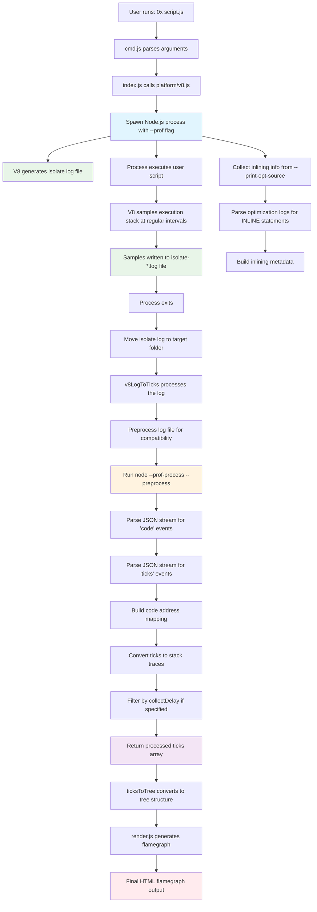

# Inspector Protocol Collection in 0x

This document describes how the 0x profiler collects performance data using V8's internal profiling mechanisms.

## Overview

The 0x profiler uses V8's built-in profiling capabilities rather than the Inspector Protocol directly. It leverages V8's `--prof` flag to generate isolate logs that contain performance sampling data.

## Collection Flow

## Key Components

### 1. Process Spawning (platform/v8.js)
- Spawns Node.js with `--prof` flag to enable V8 profiling
- Adds `--logfile` to specify isolate log location
- Includes `--print-opt-source` for optimization information
- Preloads modules for process control and port detection

### 2. Isolate Log Generation
- V8 automatically generates isolate log files with format: `isolate-{address}-{pid}-{pid}-v8.log`
- Contains sampling data with stack traces and timing information
- Records code events (function compilation, optimization)
- Records tick events (periodic stack samples)

### 3. Inlining Information Collection
- Monitors stdout for optimization logs from `--print-opt-source`
- Parses `INLINE()` statements to track function inlining
- Builds metadata about which functions were inlined and where
- Associates inlined functions with their call sites

### 4. Log Processing (lib/v8-log-to-ticks.js)
- Preprocesses isolate log for compatibility across Node.js versions
- Runs `node --prof-process --preprocess` to convert to JSON
- Streams JSON parsing to handle large log files
- Extracts code events to build address-to-function mapping
- Extracts tick events to get stack sample data

### 5. Data Transformation
- Maps raw addresses in tick samples to actual function names
- Applies collectDelay filtering to ignore initial samples
- Reverses stack order for proper call hierarchy
- Filters out invalid or incomplete samples

### 6. Output Generation
- Converts processed ticks to hierarchical tree structure
- Renders interactive HTML flamegraph visualization
- Preserves inlining information for detailed analysis

## Technical Details

### V8 Profiling Flags
- `--prof`: Enable V8 profiling and generate isolate log
- `--logfile=%p-v8.log`: Specify log filename pattern with PID
- `--print-opt-source`: Output optimization information to stdout

### Data Flow
1. **Sampling**: V8 periodically samples the call stack (every ~1ms)
2. **Logging**: Stack samples written to isolate log with timestamps
3. **Processing**: Log converted to JSON format for parsing
4. **Mapping**: Raw addresses mapped to function names and locations
5. **Aggregation**: Samples grouped and counted to build execution profile

### Compatibility Handling
- Different preprocessing for Node.js versions 8, 10, and 11+
- Handles V8 log format changes across versions
- Escapes problematic characters that break preprocessing
- Filters out excessively long log lines that cause crashes

## Benefits of This Approach

- **Low Overhead**: Uses V8's built-in sampling profiler
- **High Accuracy**: Captures actual execution without instrumentation
- **Complete Coverage**: Profiles both JavaScript and native code
- **Inlining Aware**: Tracks function inlining for accurate attribution
- **Version Compatible**: Works across different Node.js versions